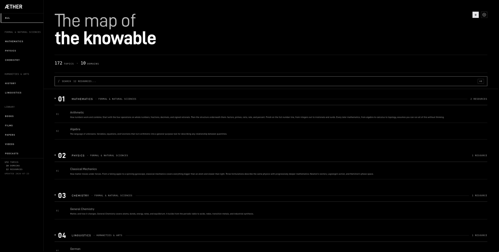
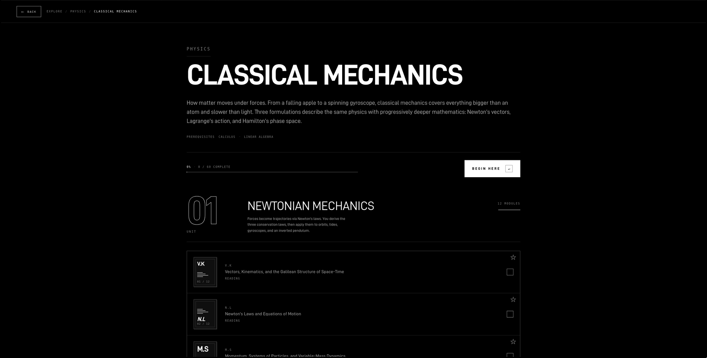
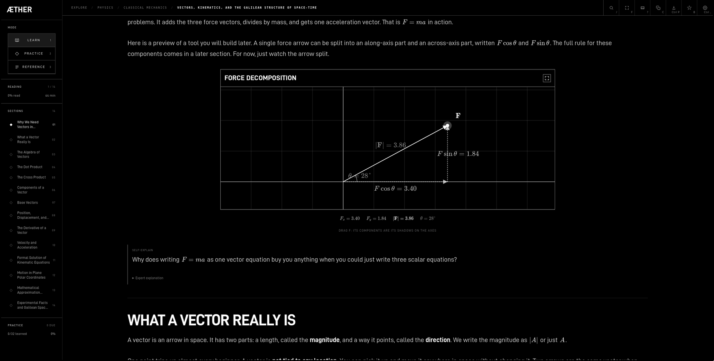

<p align="center">
  
</p>

<p align="center">
  <a href="LICENSE"></a>
  <a href="LICENSE"></a>
  <a href="https://github.com/sponsors/StilyanX"></a>
</p>

<p align="center"><strong>No streaks. No points. No accounts. Just knowledge.</strong></p>

<p align="center">A free, self-hosted learning platform. Every subject, in plain language, full depth.<br>Community-built. Forever free.</p>

---

<p align="center">
  
</p>
<p align="center">
  
</p>
<p align="center">
  
</p>

---

## Why Aether

Most learning platforms are built to keep you on the platform. Aether is built to get knowledge into your head, then get out of the way.

- **No gamification.** No streaks, badges, leaderboards, or daily limits. A platform that rewards showing up is optimizing for showing up, not for learning.
- **No accounts.** No data about you is collected or transmitted. Progress lives in your browser, on your machine, under your control.
- **No paywalls.** Every topic, every tool, every flashcard. Free, permanently, not a free tier.
- **No bloat.** Installs in one command. Runs offline. No backend required.
- **Built on what actually works, not what looks good in a demo.** Retrieval practice and spaced review are the two techniques cognitive-science research rates highest for durable learning across ages and subjects. Aether builds around them: FSRS-scheduled spaced repetition, predict-and-explain cards that force retrieval before revealing the answer, LaTeX equations and interactive simulations for the concepts words alone can't carry.

---

## What's Inside

<table align="center">
  <tr>
    <td><strong>LEARN</strong></td>
    <td><strong>PRACTICE</strong></td>
    <td><strong>REFERENCE</strong></td>
  </tr>
  <tr>
    <td>Long-form articles. LaTeX equations. Interactive geometry. Code blocks. Progressive disclosure.</td>
    <td>FSRS-powered spaced repetition. Predict-and-explain cards. Locally computed intervals. Session stats.</td>
    <td>Formula sheets. Key definitions. One page per topic: what you open mid-problem, not mid-lesson.</td>
  </tr>
</table>

Each subject is sequenced so foundations come before what depends on them (algebra before functions, kinematics before dynamics), not as a fixed syllabus but as a real prerequisite chain. Skipping ahead is always possible; skipping the foundation isn't invisible when it costs you three chapters later.

**Subjects currently covered** (172 topics, plus 12 capstone exams):

- **Mathematics** (69 topics): Arithmetic (place value, fractions, decimals, number theory, rational numbers, interactive tools); Algebra (foundations, equations and inequalities, polynomials, functions, sequences, the binomial theorem)
- **Physics** (60 topics): Classical Mechanics (Newtonian, Lagrangian, Hamiltonian, rigid bodies, oscillations, perturbation theory)
- **Chemistry** (18 topics): General Chemistry (atomic structure, bonding, thermodynamics, kinetics, equilibrium, electrochemistry, analysis)
- **Languages** (10 topics): German A1
- **History** (6 topics): Prehistory, from human evolution to the first civilizations
- **Explore** (9 topics): curated books, films, papers, podcasts, videos

Arithmetic also ships 12 capstone exams, which sit outside the topic count.

More subjects ship continuously.

---

## Support the Project

Aether will always be free. If it's useful, consider sponsoring. It funds new content, new subjects, and keeps the lights on.

<p align="center">
  <a href="https://github.com/sponsors/StilyanX">
    
  </a>
</p>

---

## Installation

**Linux / macOS**

```bash
curl -fsSL https://raw.githubusercontent.com/StilyanX/aether/main/install.sh | bash
```

**Windows** (PowerShell, run as Administrator)

```powershell
irm https://raw.githubusercontent.com/StilyanX/aether/main/install.ps1 | iex
```

Open [http://localhost:8000](http://localhost:8000). Aether loads automatically.

<details>
<summary>Manual install</summary>
<br>

Install [Node.js LTS](https://nodejs.org) and [Git](https://git-scm.com), then:

```bash
git clone https://github.com/StilyanX/aether.git
cd aether
npm install
npm run dev
```

</details>

<details>
<summary>Troubleshooting</summary>
<br>

| Symptom                             | Fix                                                                                                      |
| ----------------------------------- | -------------------------------------------------------------------------------------------------------- |
| `curl: command not found` (Windows) | Use the PowerShell command instead                                                                       |
| `winget: command not found`         | Update Windows to 1709+ or install Node manually from [nodejs.org](https://nodejs.org)                   |
| Port 8000 already in use            | Stop the conflicting process (`lsof -ti:8000 \| xargs kill`) or change `server.port` in `vite.config.js` |
| Blank page or 404                   | Navigate to [http://localhost:8000/aether/](http://localhost:8000/aether/) manually          |

</details>

---

## Ways to Contribute

Aether is built by one person so far. The point of it being open source is that it should not stay that way.

There is no fixed list of what you can contribute. If you know something, write it. If something is broken, fix it. If something could be clearer, improve it. If a subject is missing, add it. If a visualization would make something click, build it.

A few examples to get started:

- **Content:** topic articles, flashcard decks, reference sheets, worked examples
- **Visualizations:** interactive diagrams, physics simulations, geometry tools
- **Code:** bug fixes, performance, accessibility, packaging, new features
- **Review:** fact-check a chapter, improve an explanation, catch an error

See CONTRIBUTING.md for dev setup. See WANTED.md for concrete asks.

### The Wanted List

`WANTED.md` is a flat list of concrete asks. Comment on the corresponding issue to claim one. If what you want to add is not on the list, open an issue first.

### What This Project Will Not Become

A few choices are not up for change. Contributions that move against them will be declined:

- No accounts.
- No backend.
- No streaks, XP, badges, daily goals, notifications, or engagement metrics.
- No paywall, subscriptions, premium tier, or telemetry.

Everything else is open. To argue with one of the above, open an issue with `track:design-principles`.

---

### Stack

<p>
  
  
  
  
  
  
</p>

### Privacy

No accounts. No backend. No cookies. No telemetry, no analytics, no crash reporting. All progress is stored locally in `localStorage` and `IndexedDB`, and no data about you is ever collected or transmitted.

Aether does load assets from third-party hosts: fonts from Google Fonts, MathJax and Prism from jsDelivr, and images from Wikimedia Commons, Open Library, Google Books, and YouTube. Your browser contacts those hosts directly, which means they can see your IP address and which page requested the asset. That is the standard consequence of loading anything from a CDN, and it is the only way information about you leaves your machine. [`NOTICE`](NOTICE) lists every external host and what it serves. Self-host the assets if you want a fully airtight setup.

### Standards

WCAG 2.2 accessible. ARIA labels on interactive elements. 2px focus indicators. `prefers-reduced-motion` support. Sub-second first paint.

### License

Platform code (`src/`, `public/`, config files): [MIT](LICENSE).
Learning content (`src/features/`): [CC BY-NC-SA 4.0](LICENSE).

<details>
<summary>Attribution</summary>
<br>

Content is derived from university-level textbooks and educational materials. All source material is credited on each topic page. Content is rewritten in plain language, restructured for active recall, and supplemented with worked examples and visual explanations. No verbatim text is reproduced.

This use constitutes fair use under 17 U.S.C. 107: educational, non-commercial, transformative, no market substitution.

Sources include works by Kleppner & Kolenkow and others.

</details>
